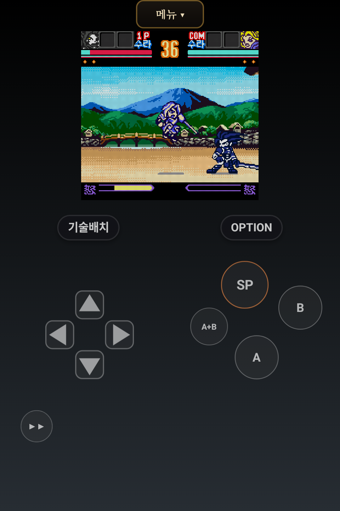
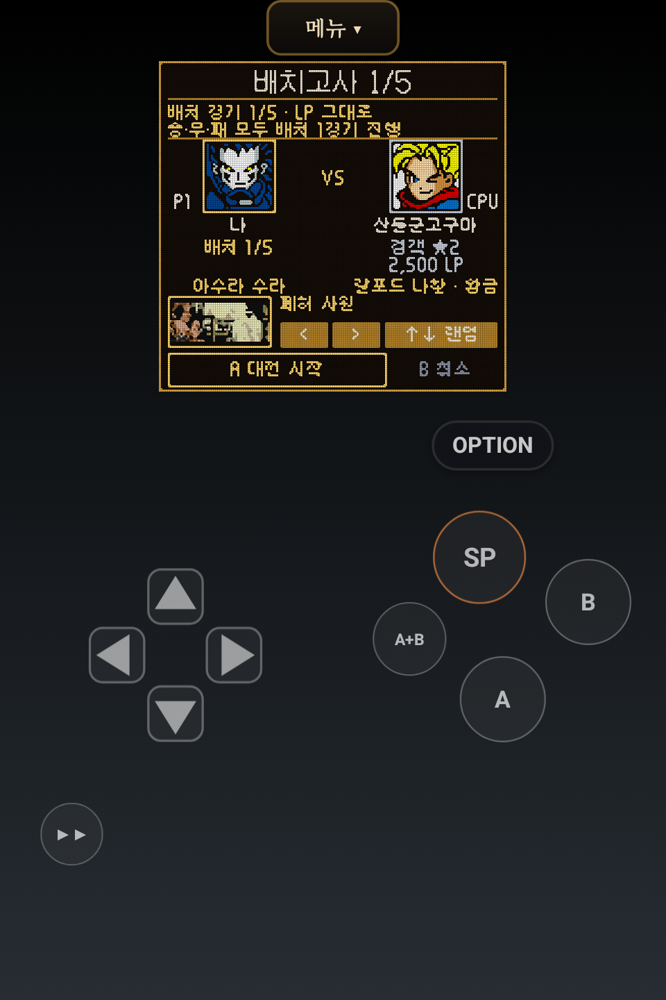
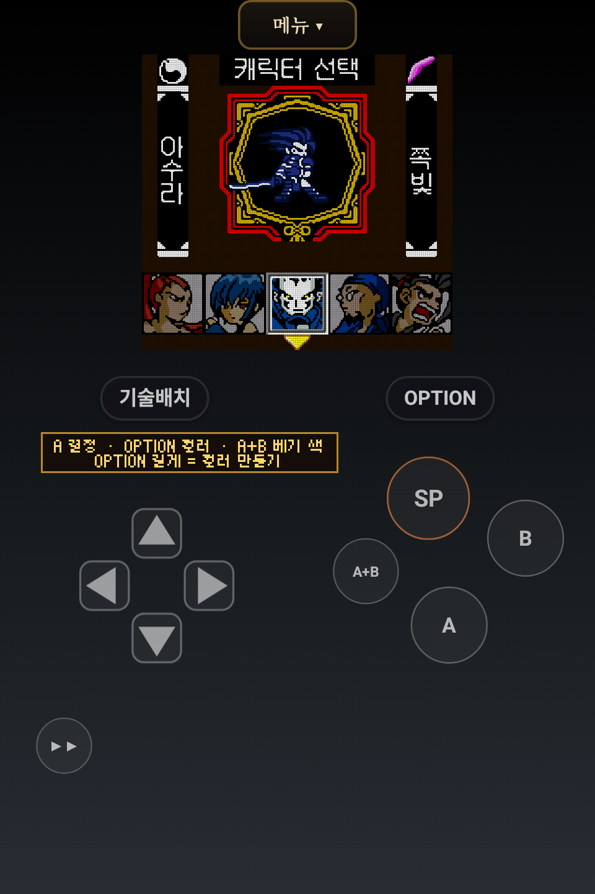

# 잔심

**NGP SS!2 커스텀 플레이어(Android)**

한패 · 가상 랭크매치 · SP키 · 컬러 추가 · 스테이지 추가

**[일반판 받기 · 68.0 MB](https://github.com/rmdkdkr-png/PocketCore/releases/download/app/zanshin-21.apk)**　|　**[라이트판 받기 · 6.2 MB](https://github.com/rmdkdkr-png/PocketCore/releases/download/app/zanshin-lite-21.apk)**

v21 · 앱 표시 버전 1.20 (21) · 2026-10-29

네오지오 포켓 컬러용 **사무라이 쇼다운! 2**를 안드로이드에서 즐기는 팬 커스텀 플레이어입니다. 한글패치, 방향별 SP 기술, CPU 가상 랭크매치에 캐릭터 컬러와 추가 무대를 더했습니다. 터치 버튼과 게임 화면의 위치·크기도 직접 조절할 수 있습니다.

## 실제 플레이 화면

  
  
  

왼쪽부터 **대전 · 가상 리그 · 캐릭터 선택**. v21 일반판을 Android 에뮬레이터에서 실행한 화면이며, 이미지를 누르면 크게 볼 수 있습니다.

## 어떤 기능이 있나요?

| 기능 | 플레이할 때 달라지는 점 |
|---|---|
| **한글패치** | 지원되는 순정 ROM에 한글패치를 적용해 플레이합니다. |
| **방향 + SP 기술** | 자주 쓰는 기술을 방향별로 배치하고 SP 버튼으로 사용합니다. 대전 중에는 현재 캐릭터·수라/나찰의 기술 배치를 바로 엽니다. |
| **가상 랭크매치** | ID와 계급을 가진 CPU와 대전하고, 배치 경기부터 점수·승급·강등을 따라 리그를 진행합니다. |
| **캐릭터 컬러와 베기색** | 캐릭터 색을 바꾸고 베기색을 선택합니다. 캐릭터 선택 화면에서 OPTION으로 컬러를 바꿀 수 있습니다. |
| **추가 무대 20종** | 대전할 무대를 고르고, 각 무대의 그림과 이름이 나오는 도입 연출을 볼 수 있습니다. |
| **화면과 조작 설정** | 화면 필터·움직임 보간을 고르고, 게임 화면과 터치 버튼의 위치·크기를 손에 맞게 조절합니다. |

원작의 수라·나찰과 카드 시스템도 함께 즐길 수 있습니다. 싱글, 연습, 무한 대전, 가상 리그 중 원하는 모드를 골라 플레이하세요.

**가상 랭크매치의 상대는 CPU입니다.** 실제 이용자와 연결되는 온라인 대전은 아닙니다. SP는 기술 입력을 돕는 기능이며, 카드·게이지 등 기술의 발동 조건은 그대로 적용됩니다.

## 처음 시작하기

1. 아래에서 일반판 또는 라이트판 APK를 받아 설치합니다.
2. 본인이 소유한 **네오지오 포켓 컬러용 사무라이 쇼다운! 2의 지원되는 순정 ROM**을 준비합니다.
3. 첫 화면의 **ROM 스캔** 또는 **폴더 선택**으로 ROM을 가져옵니다.
4. 캐릭터와 수라·나찰을 고르고 플레이합니다. **기술배치**에서 방향별 SP 기술을 확인하거나 바꿀 수 있습니다.

Android 8.0 이상이 필요합니다. ROM은 앱에 포함하지 않습니다.

## 일반판과 라이트판

| | 일반판 | 라이트판 |
|---|---|---|
| 다운로드 | **[APK · 68.0 MB](https://github.com/rmdkdkr-png/PocketCore/releases/download/app/zanshin-21.apk)** | **[APK · 6.2 MB](https://github.com/rmdkdkr-png/PocketCore/releases/download/app/zanshin-lite-21.apk)** |
| 추가 중간그림 팩 | 포함 | 제외 |
| 한글패치·SP·리그·컬러·무대 등 주요 기능 | 제공 | 제공 |

라이트판은 추가 중간그림 팩을 제외해 다운로드 크기를 줄인 판입니다. 코어의 움직임 보간과 주요 플레이 기능은 두 판에 모두 있습니다. 표의 크기는 APK 다운로드 기준이며, 설치 후 용량과 ROM·저장 데이터는 별도입니다.

이미 사용 중이라면 **같은 판의 APK로 업데이트**하세요. 기존 앱을 삭제하거나 데이터를 초기화할 필요는 없습니다. 일반판과 라이트판은 별도 앱이며, 두 판의 진행 기록이 항상 자동으로 합쳐지는 것은 아닙니다. 기록 공유를 사용 중이라면 공유 기록을 보관하는 일반판을 삭제하지 마세요.

## v21에서 달라진 점

게임 중 **기존 상단 버튼 메뉴와 OPTION 동작**을 복원했습니다. 설정·치트·버튼 배치는 기존 창으로 열리고, OPTION은 캐릭터 색 선택·일시정지·리그 쉼 메뉴에 맞게 동작합니다. v20의 기술 배치, 컬러, 무대 도입 연출은 유지합니다.

[자세한 변경 내용·검수 범위·파일 해시](docs/releases/zanshin-21.md)

검수 범위 보기

일반판 v21은 Android 에뮬레이터에서 메뉴·설정·치트·배치, 컬러 선택, 기술 배치, 일시정지·재개, 리셋, 리그 진입·저장 후 나가기를 확인했습니다. 두 판의 빌드 기록·소스·해시·서명을 대조했습니다.

라이트판은 이번 검수에서 별도로 실행하지 않았으며, 실제 휴대폰·물리 게임패드와 모든 무대·저장 슬롯·리그 결과 정산은 이번 검수 범위에 포함하지 않습니다.

## 소스와 관련 자료

- [v21 대응 소스·개발자 노트](https://github.com/rmdkdkr-png/PocketCore/releases/download/app/zanshin-21-source.zip)
- [전체 릴리스·이전 버전](https://github.com/rmdkdkr-png/PocketCore/releases/tag/app)
- [커스텀 코어 소스](https://github.com/rmdkdkr-png/ss2-sp-core) · [한글패치](https://github.com/rmdkdkr-png/KrPatch)
- [기존 PocketCore 프로젝트 안내](docs/pocketcore-legacy.md)

게임과 캐릭터·그림·음악의 권리는 SNK 등 원 권리자에게 있습니다. 잔심은 공식 제품과 무관한 비영리 팬 프로젝트입니다. ROM은 배포하지 않으며, 본인이 소유한 지원 ROM이 필요합니다. 코어는 [beetle-ngp-libretro](https://github.com/libretro/beetle-ngp-libretro)(GPL) 기반입니다. 권리자의 요청이 있으면 해당 배포물을 내립니다.
