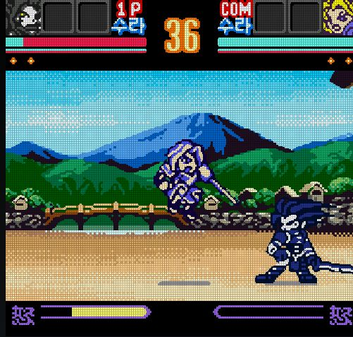
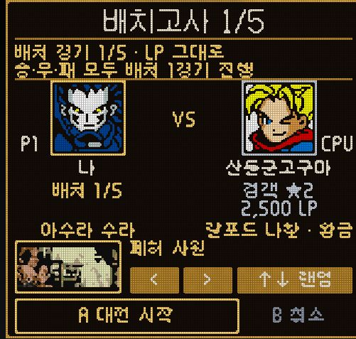
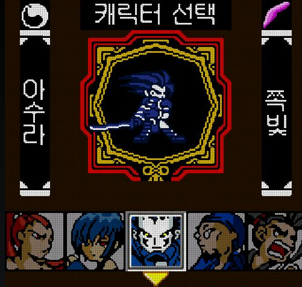

# 잔심 — NGP SS!2 커스텀 플레이어(Android)

**한패 / 가상 랭크매치 / SP키 / 컬러 추가 / 스테이지 추가**

안녕하세요. 네오지오 포켓 컬러용 **사무라이 쇼다운! 2**를 안드로이드에서 즐길 수 있도록 만든 커스텀 플레이어, **잔심을 공개합니다.**

사무라이 쇼다운! 2는 캐릭터와 함께 **수라·나찰**을 고르고, 플레이하며 얻은 **카드**로 능력과 기술을 구성하는 무기 격투게임입니다. 잔심은 원작의 대전에 한글패치, 방향별 SP 기술, CPU 가상 랭크매치와 화면·조작 설정을 더한 팬 프로젝트입니다.

<p align="center">
  <a href="docs/images/zanshin-battle-view.jpg"></a>
  <a href="docs/images/zanshin-league-view.jpg"></a>
  <a href="docs/images/zanshin-color-view.jpg"></a>
</p>

**대전 / 가상 랭크매치 / 캐릭터 선택** — 실제 실행 화면에서 게임 영역만 담았습니다. 누르면 크게 볼 수 있습니다.

## 어떤 기능을 담았나요?

**한글로 즐기는 원작**  
지원되는 순정 ROM을 가져오면 한글패치를 적용합니다. 싱글로 원작의 진행과 카드 수집을 즐기고, 연습에서 기술을 익히거나 무한 대전으로 계속 플레이할 수 있습니다. 수라·나찰과 카드 시스템은 원작의 요소입니다.

**방향과 SP 버튼으로 쓰는 기술**  
자주 쓰는 기술을 방향별로 배치하고 **방향 + SP**로 사용합니다. 기술배치 화면에서 캐릭터와 수라·나찰에 맞는 기술을 직접 고를 수 있습니다. 카드나 게이지처럼 기술에 필요한 발동 조건은 그대로 적용됩니다.

**CPU와 이어가는 가상 랭크매치**  
ID와 계급을 가진 CPU 상대와 대전합니다. 배치 경기를 거쳐 점수를 쌓고, 승급과 강등을 오가며 다음 상대를 만납니다. 중간에 저장하고 나갔다가 이어서 즐길 수도 있습니다. **실제 사람과 접속하는 온라인 대전은 아닙니다.**

**캐릭터 컬러와 추가 스테이지 20종**  
캐릭터 선택에서 OPTION으로 컬러를 바꾸고, 베기색도 고를 수 있습니다. 원작 무대에 더해 추가 스테이지 20종을 담았으며, 대전 전 상대 확인 화면에서 무대를 선택합니다.

**손에 맞추는 화면과 버튼**  
게임 화면과 터치 버튼의 위치·크기를 조절할 수 있습니다. 화면 필터와 움직임 보간도 선택해 취향에 맞게 플레이할 수 있습니다.

## 필요한 원본 ROM

**네오지오 포켓 컬러용 `Samurai Shodown! 2 (JUE)` 순정 ROM**을 준비해 주세요. 일본어·영어가 들어 있는 원본이며, 한글패치는 앱이 적용합니다.

| 확인할 것 | 필요한 조건 |
|---|---|
| 기종·게임 | **Neo Geo Pocket Color / Samurai Shodown! 2** |
| 판본 | **JUE 순정판**. 파일명 예: `Samurai Shodown! 2 (JUE) [!].ngc` |
| 파일 상태 | **한글패치·개조를 적용하지 않은 원본** |
| 파일 형식 | `.ngc`, `.ngp`, `.npc` 또는 해당 ROM이 들어 있는 `.zip`, `.7z` |
| 원본 확인 | 아래 MD5와 **압축을 푼 ROM 파일**의 MD5가 일치해야 합니다. |

```text
MD5: 8d6a36acd3b171970d87d2fca6796a4a
```

앱은 파일 이름이 아니라 **파일 내용**으로 원본을 확인합니다. 같은 이름이어도 미리 한글화하거나 수정한 파일은 인식하지 않습니다. **네오지오 아케이드용 Samurai Shodown II ROM은 사용할 수 없습니다.**

ZIP·7z가 인식되지 않으면 압축을 풀고 ROM이 들어 있는 폴더를 선택해 주세요. 암호가 걸린 압축 파일과 RAR는 지원하지 않습니다. ROM은 배포물에 포함하지 않으며, 본인이 소유한 원본이 필요합니다.

## 다운로드

**Android 8.0 이상**에서 사용할 수 있습니다.

| 판 | 다운로드 | 구성 |
|---|---|---|
| **일반판** | **[APK 받기 · 68.0 MB](https://github.com/rmdkdkr-png/PocketCore/releases/download/app/zanshin-21.apk)** | 움직임 보간용 추가 중간그림 팩 포함 |
| **라이트판** | **[APK 받기 · 6.2 MB](https://github.com/rmdkdkr-png/PocketCore/releases/download/app/zanshin-lite-21.apk)** | 추가 중간그림 팩 제외 |

한글패치·SP 기술·가상 리그·컬러·추가 무대 등 주요 기능은 두 판에 모두 있습니다. 라이트판에서도 코어의 움직임 보간을 사용할 수 있습니다. 두 판은 별도 앱으로 설치되며, 표의 용량은 APK 다운로드 기준입니다.

## 시작하기

1. 일반판 또는 라이트판 APK를 설치합니다.
2. 위 조건에 맞는 순정 ROM을 휴대폰에 준비합니다.
3. 첫 화면의 **ROM 스캔** 또는 **폴더 선택**으로 ROM을 가져옵니다.
4. **플레이**를 누르고 캐릭터와 수라·나찰을 고릅니다. 연습에서 방향 + SP 기술부터 확인해 보세요.

가져온 뒤에는 인터넷 연결 없이 플레이할 수 있습니다.

---

[소스 코드](https://github.com/rmdkdkr-png/PocketCore/releases/download/app/zanshin-21-source.zip) · [배포 파일](https://github.com/rmdkdkr-png/PocketCore/releases/tag/app) · [자세한 배포 자료](https://github.com/rmdkdkr-png/PocketCore/blob/main/docs/releases/zanshin-21.md)

본문 이미지는 Android 에뮬레이터에서 실행한 게임 화면입니다. 게임과 캐릭터·그림·음악의 권리는 SNK 등 원 권리자에게 있습니다. 잔심은 공식 제품과 무관한 비영리 팬 프로젝트입니다. 코어는 [beetle-ngp-libretro](https://github.com/libretro/beetle-ngp-libretro)(GPL) 기반이며, [커스텀 코어](https://github.com/rmdkdkr-png/ss2-sp-core)와 [한글패치](https://github.com/rmdkdkr-png/KrPatch) 관련 자료도 공개되어 있습니다.
